Hi, I am Ranbeer Malhotra and I love Linux, maintaining my homelab, blogging and learning new tech.

Checkout my blog at:

https://blog.penguinthoughts.tech/

### Currently Learning

- C and Python from [CS50x: Introduction to Computer Science](https://cs50.harvard.edu/x/)
- **Full Stack Javascript** from [The Odin Project](https://www.theodinproject.com/paths/full-stack-javascript/courses/javascript)

### Completed

- **Foundation Path** of [The Odin Project](https://www.theodinproject.com/)
- **Full Stack Javascript** from [The Odin Project](https://www.theodinproject.com/paths/full-stack-javascript/courses/intermediate-html-and-css) (Intermediate HTML and CSS Progress: 100%)

<h3>My Stats and Languages</h3>

|Stats|Languages|
|-------|--------|
 | 

  
<h3>My badges</h3>

  

